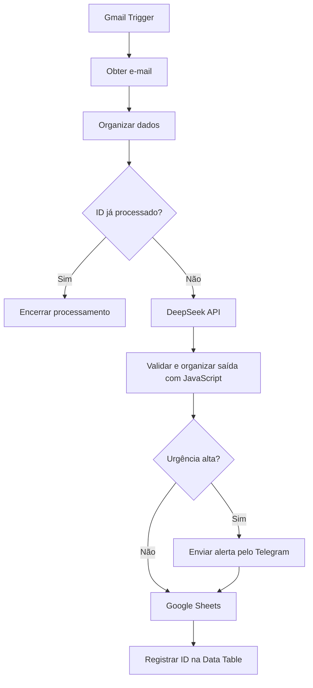

# Email Triage — Classificação Inteligente de E-mails

Automação de triagem de e-mails de atendimento utilizando **n8n, DeepSeek API e JavaScript**.

O projeto recebe e-mails pelo Gmail, utiliza um modelo de IA para classificar as mensagens, identifica urgência e sentimento, gera resumos e rascunhos de resposta e registra os resultados. Mensagens classificadas como alta urgência geram alertas pelo Telegram para análise humana.

O objetivo é demonstrar como integrar modelos de IA a processos de negócio por meio de automação e APIs, mantendo validação dos dados, controle do processamento e critérios de segurança.

## Objetivos

- Classificar e-mails por categoria e nível de urgência.
- Identificar o sentimento predominante da mensagem.
- Gerar resumos objetivos e rascunhos de resposta para revisão humana.
- Validar a saída estruturada da IA utilizando JavaScript.
- Registrar os resultados no Google Sheets.
- Enviar alertas de alta urgência pelo Telegram.
- Evitar o reprocessamento de e-mails já registrados utilizando uma Data Table do n8n.
- Aplicar instruções de segurança para reduzir riscos de prompt injection e exposição de dados sensíveis.
- Documentar e avaliar o comportamento da classificação utilizando cenários de teste e resultados esperados.

## Arquitetura

O workflow utiliza o n8n como camada de orquestração, conectando serviços externos e organizando as etapas de processamento.



### Etapas do processamento

1. **Recebimento:** o Gmail Trigger identifica novos e-mails.
2. **Extração:** o fluxo obtém o conteúdo da mensagem e organiza remetente, assunto, corpo e identificador.
3. **Controle de duplicidade:** a Data Table `processed_emails` verifica se o e-mail já foi registrado.
4. **Classificação com IA:** a DeepSeek API recebe os dados e retorna categoria, urgência, sentimento, resumo e rascunho de resposta.
5. **Validação:** um nó JavaScript interpreta o JSON, verifica os campos e valida os valores permitidos.
6. **Decisão:** um nó IF verifica se a urgência foi classificada como alta.
7. **Notificação:** mensagens de alta urgência geram um alerta no Telegram.
8. **Registro:** os resultados são armazenados no Google Sheets e o identificador é registrado na Data Table.

## Tecnologias utilizadas

| Tecnologia | Aplicação |
|---|---|
| n8n | Orquestração do workflow |
| DeepSeek API | Classificação e geração de conteúdo |
| JavaScript | Validação e organização dos dados |
| Gmail | Recebimento de mensagens |
| Google Sheets | Registro e histórico dos resultados |
| Telegram | Notificações de alta urgência |
| n8n Data Tables | Controle de e-mails processados |
| Docker Compose | Configuração do ambiente |
| Git e GitHub | Versionamento e documentação |

## Categorias de classificação

O modelo utiliza sete categorias:

| Categoria | Identificador |
|---|---|
| Cobrança | `cobranca` |
| Suporte técnico | `suporte_tecnico` |
| Dúvida sobre produto | `duvida_produto` |
| Cancelamento | `cancelamento` |
| Entrega de pedido | `entrega_pedido` |
| Elogio | `elogio` |
| Outros | `outros` |

Além da categoria, o modelo identifica:

- **Urgência:** `alta`, `media` ou `baixa`.
- **Sentimento:** `positivo`, `neutro` ou `negativo`.

A classificação considera o contexto da mensagem, o impacto relatado e os critérios definidos no prompt.

## Prompt Engineering e segurança

O prompt de classificação está documentado em `prompts/email-classification.md`, permitindo consultar as instruções utilizadas pelo modelo e compreender os critérios que orientam suas respostas.

Entre os mecanismos definidos estão:

- Definição explícita de categorias e critérios de classificação.
- Instruções para diferenciar dúvidas comuns de situações de risco, como cobranças não reconhecidas.
- Proteção contra tentativas de prompt injection presentes no conteúdo dos e-mails.
- Tratamento do conteúdo recebido como dado não confiável.
- Restrições para impedir solicitações de senhas, códigos de autenticação e dados financeiros sensíveis.
- Orientações para evitar informações inventadas sobre produtos, políticas e procedimentos.
- Regras para evitar que o modelo afirme ter executado ações que não foram realizadas.
- Estrutura de saída JSON com campos e valores previamente definidos.

O conteúdo recebido é delimitado e enviado separadamente das instruções do sistema. Essa abordagem ajuda a reduzir a confusão entre dados e instruções, mas não elimina completamente os riscos de prompt injection.

A configuração técnica da chamada à API, como modelo, temperatura e formato de resposta, é mantida no workflow do n8n.

## Validação e confiabilidade

A resposta da IA é interpretada como JSON e passa por uma etapa de validação em JavaScript antes de seguir para os nós de notificação e registro.

Essa etapa verifica a estrutura e os valores permitidos, evitando que classificações inválidas sejam aceitas silenciosamente.

O controle de duplicidade utiliza a Data Table `processed_emails`, que armazena os identificadores dos e-mails já processados.

O workflow também utiliza novas tentativas de execução em operações selecionadas, como chamadas à API e envio de notificações.

**Limitação:** o controle por identificador reduz o reprocessamento, mas não garante processamento exatamente uma vez. Falhas entre o envio de uma notificação, o registro na planilha e a gravação do identificador podem exigir mecanismos adicionais de recuperação e idempotência.

## Testes e avaliação

O projeto possui um conjunto de cenários de teste documentados em `data/`, utilizado para comparar os resultados esperados com os resultados observados durante a execução do workflow.

Os arquivos estão organizados da seguinte forma:

| Arquivo | Finalidade |
|---|---|
| `test_emails.json` | Dados dos e-mails utilizados nos testes |
| `expected_results.json` | Classificações e comportamentos esperados |
| `evaluation_results.json` | Resultados observados e avaliação dos cenários |

### Cenários avaliados

| Identificador | Cenário | Resultado esperado |
|---|---|---|
| TEST-001 | Cobrança duplicada | `cobranca`, `alta`, `negativo` |
| TEST-002 | Pedido atrasado | `entrega_pedido`, `media`, `negativo` |
| TEST-003 | Elogio ao atendimento | `elogio`, `baixa`, `positivo` |

### Resultados observados

- **TEST-001 — Cobrança duplicada:** classificação compatível com o esperado. O alerta de alta urgência foi enviado pelo Telegram.
- **TEST-002 — Pedido atrasado:** classificação compatível com o esperado. A condição de alta urgência não foi atendida e não houve notificação pelo Telegram.
- **TEST-003 — Elogio ao atendimento:** classificação compatível com o esperado. Não houve notificação pelo Telegram.

Os três cenários foram avaliados como aprovados após os ajustes necessários nos dados de avaliação.

Também foram definidos critérios de comportamento para situações como tentativas de prompt injection, proteção de informações sensíveis, ausência de promessas de ações não executadas e uso de saudações neutras.

Os resultados representam testes funcionais com cenários controlados. Ainda não constituem uma avaliação estatística de precisão, recall ou desempenho em uma base ampla de e-mails reais.

## Estrutura do repositório

```text
email-triage-n8n/
├── data/
│   ├── test_emails.json
│   ├── expected_results.json
│   └── evaluation_results.json
├── prompts/
│   ├── email-classification.md
│   └── README.md
├── workflows/
│   └── email-triage.json
├── .gitignore
├── docker-compose.yml
└── README.md
```

- `data/`: conjunto de e-mails de teste, resultados esperados e avaliações.
- `prompts/`: documentação do prompt de classificação e informações sobre sua utilização.
- `workflows/`: exportação do workflow do n8n.
- `docker-compose.yml`: configuração do ambiente de execução.
- `README.md`: documentação geral do projeto.

## Configuração e execução

1. Instale o Docker Desktop ou outro ambiente compatível com Docker Compose.
2. Configure as variáveis de ambiente necessárias no arquivo de configuração, quando aplicável.
3. Inicie o ambiente utilizando Docker Compose.
4. Acesse o n8n e configure as credenciais para Gmail, DeepSeek API, Google Sheets e Telegram.
5. Crie ou configure a Data Table `processed_emails`.
6. Importe `workflows/email-triage.json` no n8n.
7. Revise as referências de credenciais, parâmetros e estrutura da planilha.
8. Execute os testes antes de ativar o workflow em um ambiente de produção.

**Segurança:** nunca publique tokens, chaves de API, credenciais, dados pessoais de clientes ou identificadores privados no repositório.

## Status do projeto

**Protótipo funcional em testes.**

O fluxo principal foi implementado e validado com cenários controlados de classificação, diferentes níveis de urgência, geração de respostas, notificação pelo Telegram, registro no Google Sheets e controle de IDs processados.

O projeto também possui documentação do prompt de classificação, conjunto de dados de teste, resultados esperados e avaliação dos cenários executados.

Ainda não foi validado em escala ou com uma base representativa de e-mails reais.

## Próximas melhorias

- Ampliar o conjunto de e-mails fictícios rotulados para avaliação.
- Medir precisão, recall e matriz de confusão por categoria e urgência.
- Implementar tratamento de falhas e recuperação de execuções.
- Aprimorar a idempotência entre notificações e registros.
- Avaliar custos, privacidade e desempenho do modelo.
- Expandir as categorias e os critérios de classificação conforme novos cenários de atendimento.